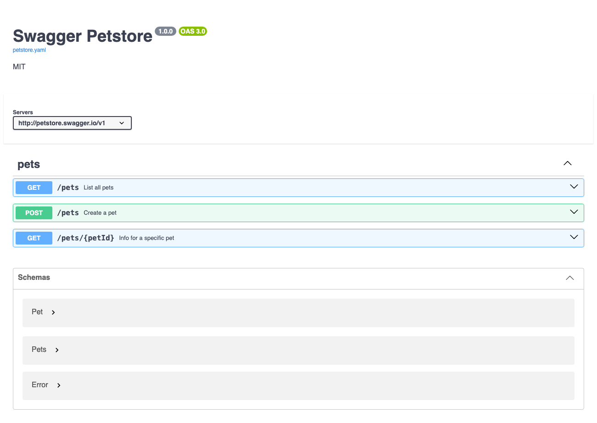
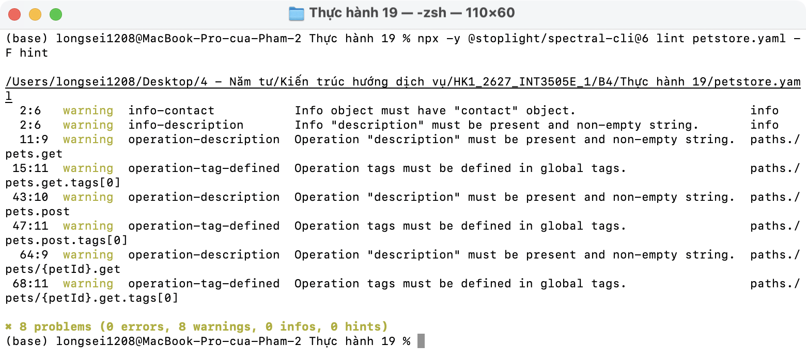

# Thực hành 19 · Phân tích Petstore

File: [petstore.yaml](petstore.yaml) (ví dụ chính thức của OpenAPI Initiative, OAS 3.0.0).

| # | Điểm | Petstore | Tasks API (Thực hành 20) |
| - | ---- | -------- | ------------------------ |
| ① | `operationId` unique | Có: `listPets`, `createPets`, `showPetById` | `listTasks`, `createTask`, `getTaskById`, `patchTask`, `deleteTask` |
| ② | Tái dùng schema | `Pets` là mảng `$ref` tới `Pet` | `$ref` cho schemas, parameters, responses |
| ③ | Response lỗi | Chỉ có `default` chung, không có 4xx cụ thể | 401, 404, 422 riêng, body `application/problem+json` |
| ④ | Tag | Một tag `pets`, không khai báo ở `tags` gốc | Tag `tasks` khai báo ở gốc, có mô tả |
| ⑤ | Security | Không có | `bearerAuth` (JWT) áp dụng toàn API |

Thêm:
- Không có `example` nào → Swagger UI chỉ hiện giá trị mặc định (`"string"`, `0`).
- `POST /pets` dùng luôn schema `Pet` (bắt buộc `id`) làm body → client phải tự gửi id.
- Không có endpoint xoá (`deletePet`).

Spectral lint Petstore: 8 warning (thiếu `contact`, `description`, tag chưa khai báo):

