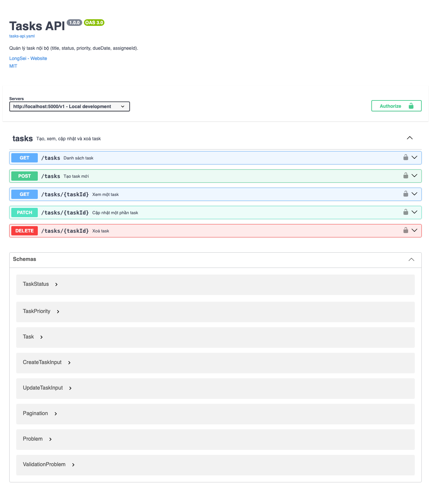
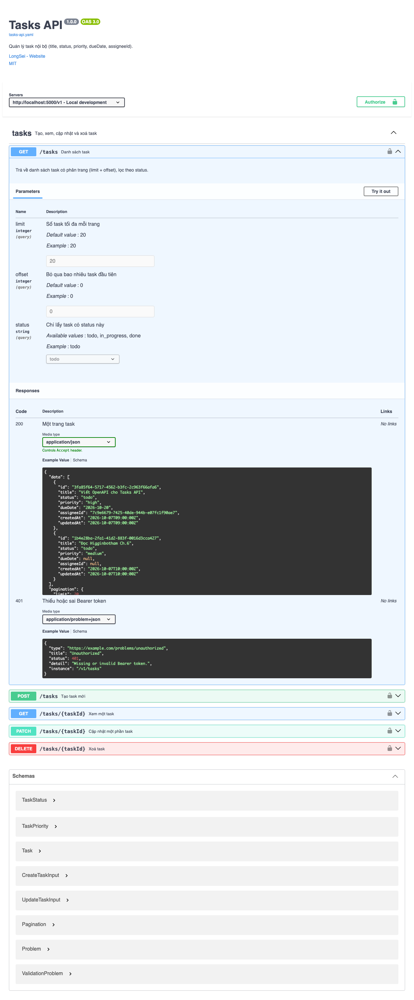
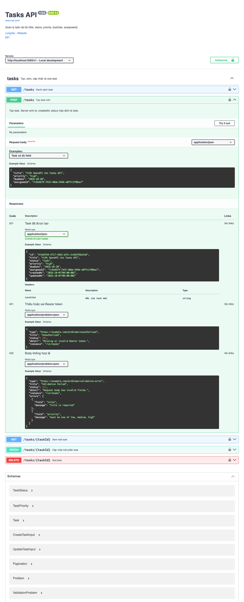
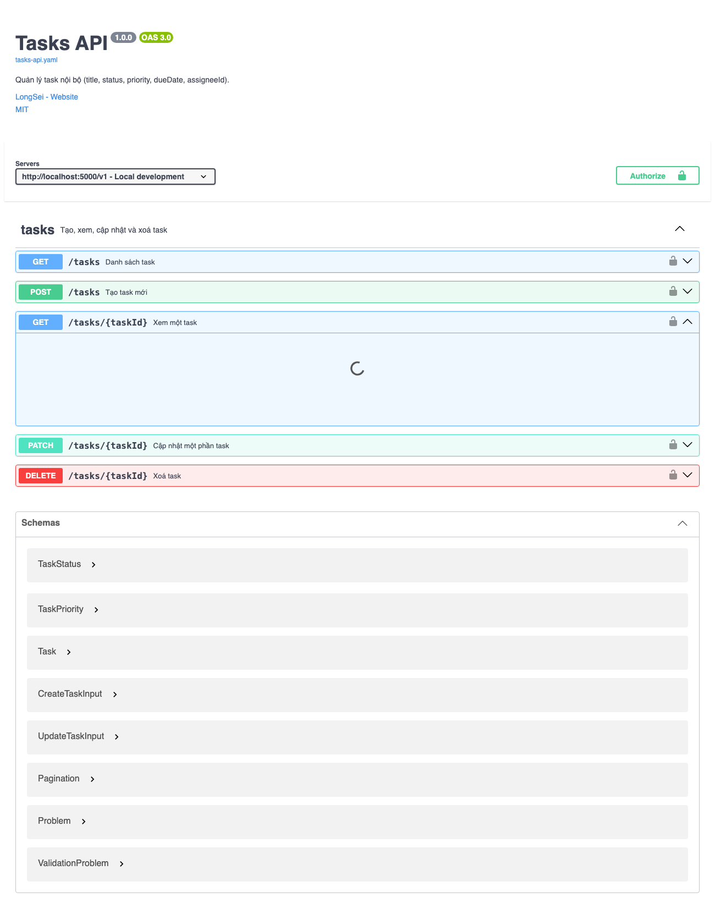
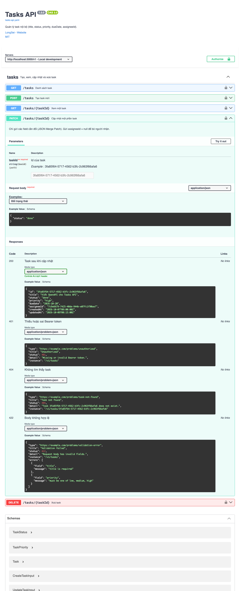
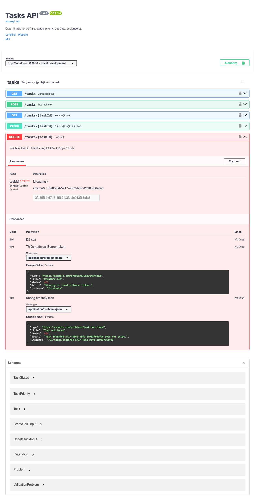

# Thực hành 20 · OpenAPI cho Tasks API

File nộp: [tasks-api.yaml](tasks-api.yaml) (OpenAPI 3.0.3)

| Method | Path | operationId | Response |
| ------ | ---- | ----------- | -------- |
| GET | `/tasks` | `listTasks` | 200, 401 |
| POST | `/tasks` | `createTask` | 201 (+ `Location`), 401, 422 |
| GET | `/tasks/{taskId}` | `getTaskById` | 200, 401, 404 |
| PATCH | `/tasks/{taskId}` | `patchTask` | 200, 401, 404, 422 |
| DELETE | `/tasks/{taskId}` | `deleteTask` | 204, 401, 404 |

Mọi parameter, request body và response đều có `example` để Swagger UI hiển thị.

Xem Swagger UI:

```bash
python3 -m http.server 8000
# mở http://localhost:8000/index.html
```



### GET /tasks



### POST /tasks



### GET /tasks/{taskId}



### PATCH /tasks/{taskId}



### DELETE /tasks/{taskId}


