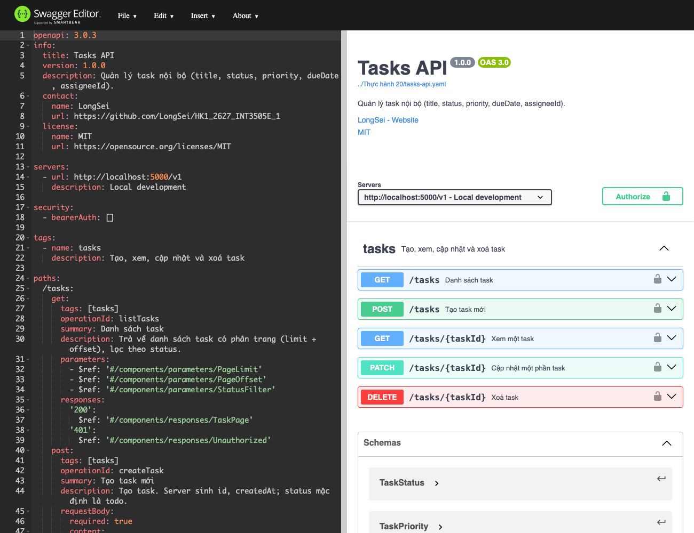
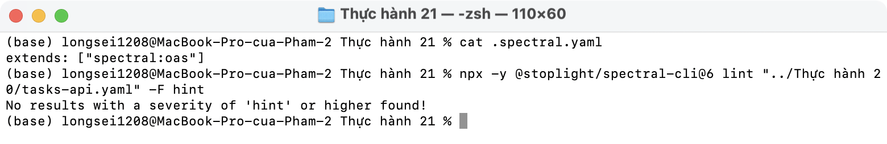
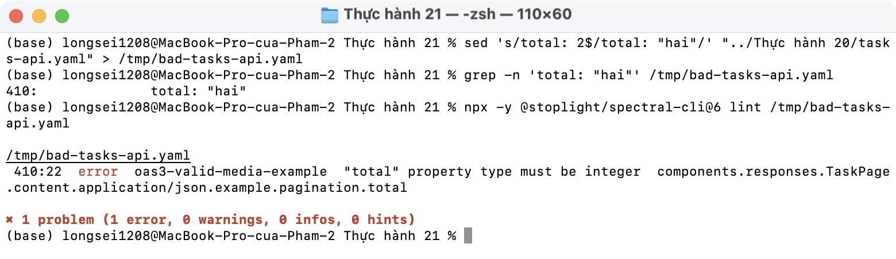
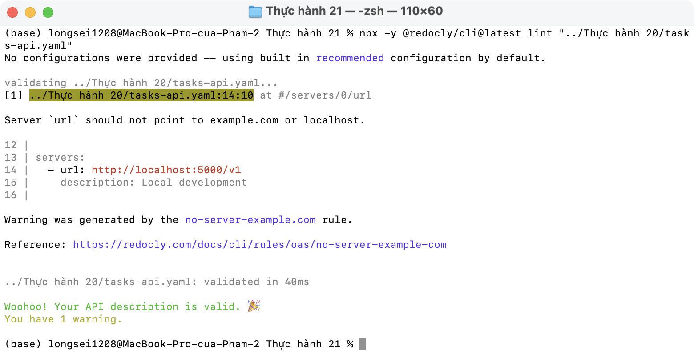

# Thực hành 21 · Validate spec

### Mức 1 · Swagger Editor

Load [tasks-api.yaml](../Thực%20hành%2020/tasks-api.yaml) vào Swagger Editor ([editor.html](editor.html)): không có lỗi.

```bash
# chạy ở thư mục B4
python3 -m http.server 8000
# mở http://localhost:8000/Thực hành 21/editor.html
```



### Mức 2 · Spectral CLI

Ruleset: [.spectral.yaml](.spectral.yaml) (`spectral:oas`). Không có error/warning/hint:



Spectral kiểm tra cả `example` so với schema. Thử đổi `total: 2` thành `"hai"`:



### Mức 3 · Redocly CLI

Valid, còn 1 warning vì server là `localhost:5000` (theo đề bài):


