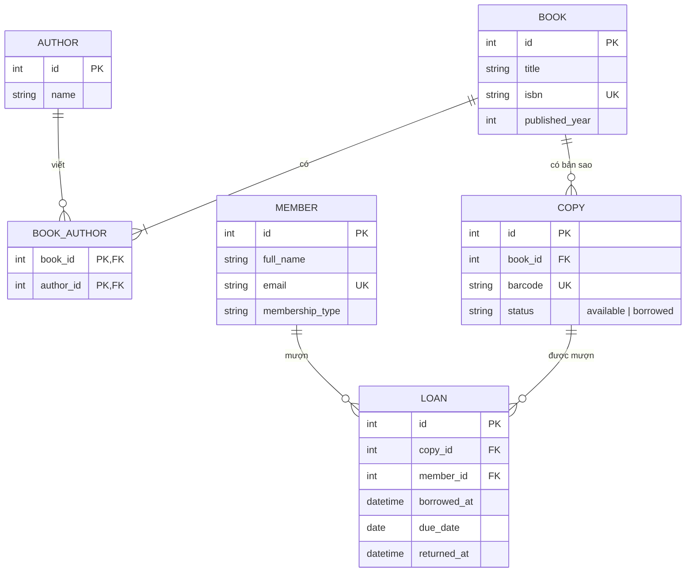
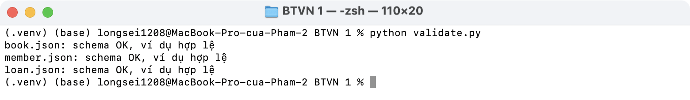

# BTVN 1 · Resource Design: Thư viện

Đề: chọn một domain, vẽ ERD, thiết kế resource set + URL list 12–20 endpoints, viết JSON Schema cho 3 resource chính.

- PDF (ERD + URL list): [BTVN1_ThuVien.pdf](BTVN1_ThuVien.pdf), xuất từ [design.html](design.html)
- JSON Schema: [schemas/book.json](schemas/book.json), [schemas/member.json](schemas/member.json), [schemas/loan.json](schemas/loan.json)

Giả định: thư viện có nhiều đầu sách, mỗi đầu sách có nhiều bản sao; độc giả mượn từng bản sao, hạn trả 14 ngày; một đầu sách có thể có nhiều tác giả.

## ERD



## URL list (14 endpoints, base `/api/v1`)

| # | Method | URL | Mô tả | Status |
| - | ------ | --- | ----- | ------ |
| 1 | GET | `/books?q=&author_id=` | Tìm / lọc đầu sách | 200 |
| 2 | POST | `/books` | Thêm đầu sách | 201, 400 |
| 3 | GET | `/books/{bookId}` | Chi tiết đầu sách | 200, 404 |
| 4 | PATCH | `/books/{bookId}` | Sửa đầu sách | 200, 400, 404 |
| 5 | DELETE | `/books/{bookId}` | Xoá đầu sách | 204, 404, 409 |
| 6 | GET | `/books/{bookId}/copies` | Bản sao của đầu sách | 200, 404 |
| 7 | POST | `/books/{bookId}/copies` | Thêm bản sao | 201, 404 |
| 8 | GET | `/authors` | Danh sách tác giả | 200 |
| 9 | GET | `/authors/{authorId}/books` | Sách của tác giả | 200, 404 |
| 10 | POST | `/members` | Đăng ký độc giả | 201, 400 |
| 11 | GET | `/members/{memberId}` | Thông tin độc giả | 200, 404 |
| 12 | POST | `/loans` | Mượn sách `{copyId, memberId}` | 201, 400, 409 |
| 13 | GET | `/loans?member_id=&status=` | Danh sách lượt mượn | 200 |
| 14 | PATCH | `/loans/{loanId}` | Trả sách `{"status": "returned"}` | 200, 404, 409 |

Bản sao phụ thuộc đầu sách nên dùng nested URL `/books/{id}/copies`; lượt mượn liên quan cả bản sao và độc giả nên để top-level `/loans` và lọc bằng `?member_id=`.

## Kiểm tra JSON Schema

```bash
source .venv/bin/activate
pip install -r requirements.txt
python validate.py
```


