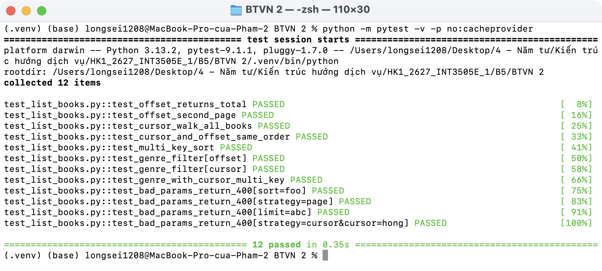
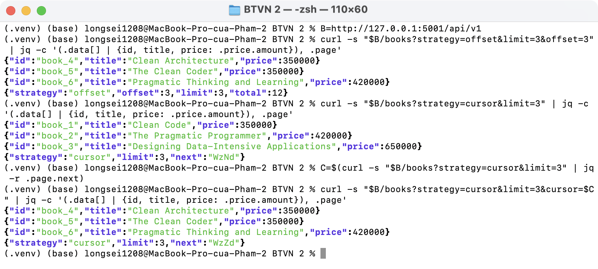
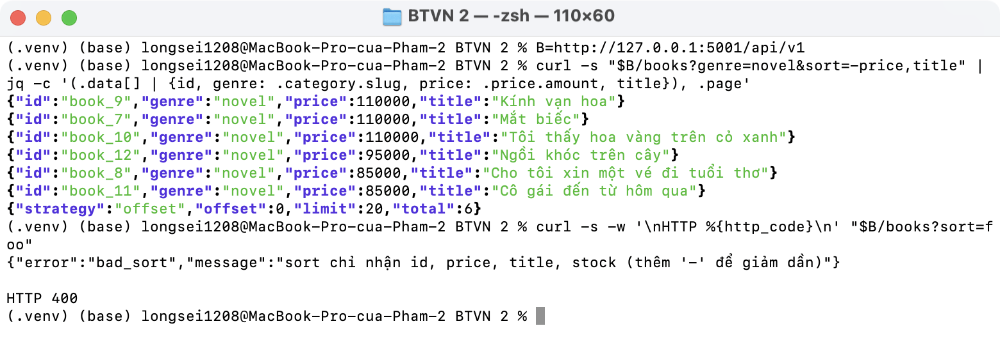
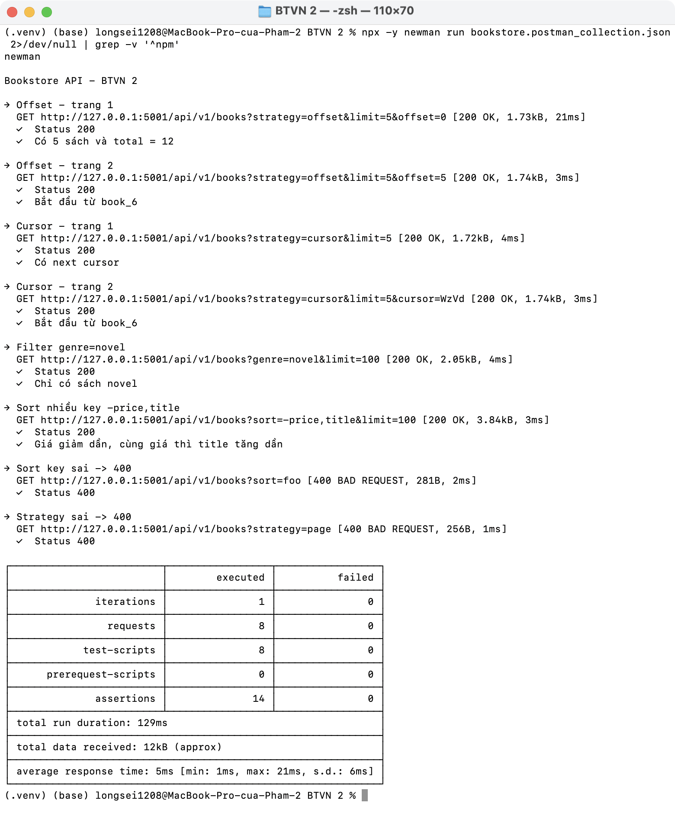
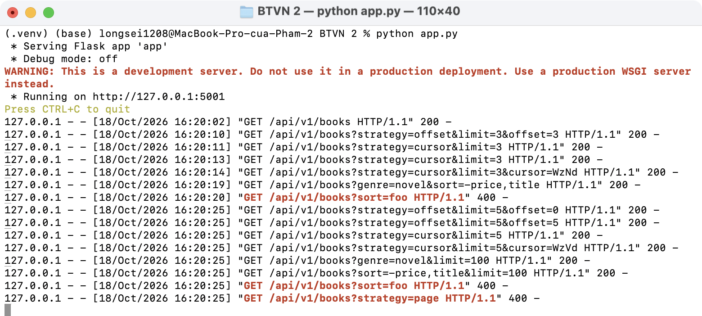

# BTVN 2 · Flask pagination

Đề: hoàn thiện `list_books` ở Lab 1: implement cả offset và cursor (chọn qua `?strategy=...`) + thêm filter `?genre` + sort multi-key.
Nộp: Git repo với tests + Postman collection.

Code dựa trên Lab 1/Lab 2. Phần làm thêm nằm ở [routes/pagination.py](routes/pagination.py) và hàm `list_books` trong [routes/books.py](routes/books.py).

## API

`GET /api/v1/books`

| Param | Ví dụ | Ghi chú |
| ----- | ----- | ------- |
| `strategy` | `offset` (mặc định), `cursor` | |
| `limit` | `20` | Tối đa 100 |
| `offset` | `5` | Dùng với `strategy=offset` |
| `cursor` | `WzNd` | Dùng với `strategy=cursor`, lấy từ `page.next` |
| `genre` | `novel` | Lọc theo thể loại (slug của Category) |
| `sort` | `-price,title` | Nhiều key cách nhau bằng dấu phẩy, `-` = giảm dần. Chỉ nhận `id`, `price`, `title`, `stock` |

Response:

```json
// strategy=offset
{"data": [...], "page": {"strategy": "offset", "offset": 0, "limit": 5, "total": 12}}
// strategy=cursor
{"data": [...], "page": {"strategy": "cursor", "limit": 5, "next": "WzVd"}}
```

Cursor lưu giá trị các cột sort của cuốn cuối trang (VD sort `-price,title` → `[350000, "Clean Architecture", 4]`, có thêm `id` để không bị trùng). Trang sau lấy các sách đứng sau giá trị đó.

## Chạy

```bash
source .venv/bin/activate
pip install -r requirements.txt
pytest -v
python app.py                                        # http://127.0.0.1:5001
npx newman run bookstore.postman_collection.json     # hoặc Import file vào Postman
```

## Kết quả

Tests:



Offset và cursor:



Filter `genre` + sort nhiều key; sort key sai → 400:



Postman collection ([bookstore.postman_collection.json](bookstore.postman_collection.json)):



Log server:


