# Lab 1 · Bookstore API: Resource Design + Flask/SQLAlchemy

Yêu cầu nghiệp vụ: sách online cho phép xem, đánh giá, mua; sách có nhiều tác giả và 1 thể loại; khách đánh giá 1–5 sao; tác giả xem danh sách sách của mình.

## Phần A · Thiết kế (quy trình 4 bước)

### A1. Xác định entity

| Entity (có lifecycle riêng) | Value object (thuộc tính) |
| --------------------------- | ------------------------- |
| Book, Author, Category, User, Review | `price` = {amount, currency}; `role` của tác giả trong một cuốn sách |

Order / OrderItem nằm ngoài phạm vi Lab 1.

### A2. Đặt tên resource và ID

| Resource | URL | ID |
| -------- | --- | -- |
| Book | `/api/v1/books` | `book_42` |
| Author | `/api/v1/authors` | `auth_15` |
| Category | `/api/v1/categories` | `cat_3` |
| User | `/api/v1/users` | `u_7` |
| Review | `/api/v1/reviews` | `rev_9` |

### A3. Quan hệ và ERD

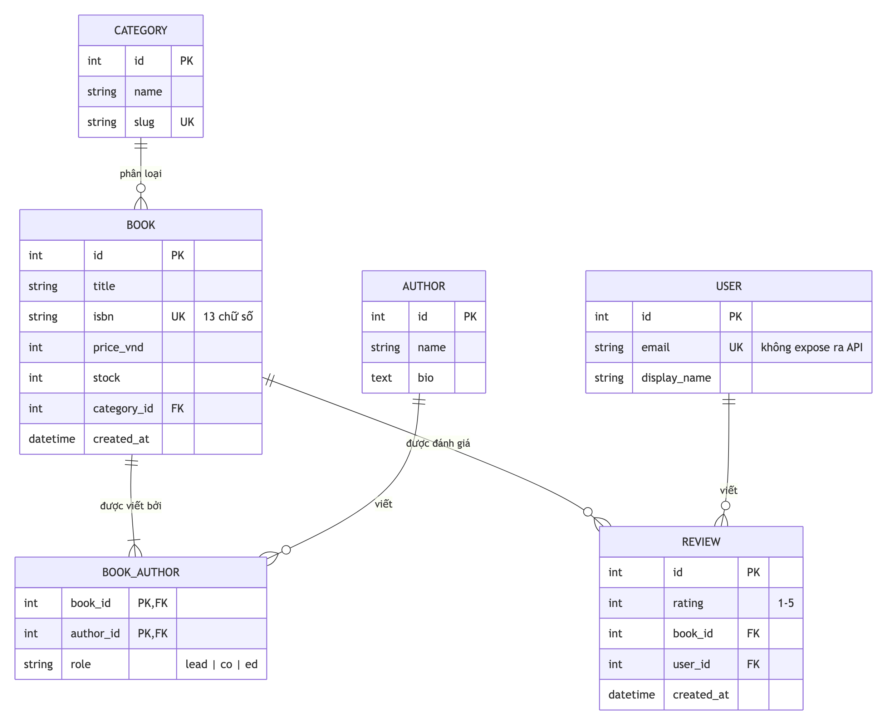

Chọn URL theo cây quyết định:

| Quan hệ | Quyết định | URL |
| ------- | ---------- | --- |
| Book 1:N Review | Q1: xoá sách thì review mất ý nghĩa → **nested** | `GET/POST /books/{id}/reviews` |
| User 1:N Review | Q2: review không cần nhiều context từ user → **top-level + filter** | `GET /reviews?user_id=u_1` |
| Category 1:N Book | Q1: sách vẫn tồn tại khi đổi thể loại → **top-level + filter** (Lab 2) | `GET /books?category=tech` |
| Book N:M Author | Q3: cặp có metadata `role` → **nested + pair** | `POST /books/{id}/authors` `{authorId, role}` |
| Tác giả xem sách | Requirement | `GET /authors/{id}/books` |

Q4: không URL nào sâu quá 2 cấp.

### A4. Schema qua 3 lớp

| Entity | DB ([models.py](models.py)) | Domain | API (`to_dict`) | Vì sao |
| ------ | --------------------------- | ------ | --------------- | ------ |
| Book | `books(id, title, isbn, price_vnd, stock, category_id, created_at)` | có `category`, `author_links` (→ `BookAuthor` → `Author`), `reviews` | `{id: "book_42", title, isbn, price: {amount, currency}, stock, category: {...}, authors: [{id, name, role}], createdAt}` | `price_vnd` lộ cách lưu → value object; category nhỏ, cần hiển thị ngay → embed; authors gộp 2 bảng; reviews nhiều → không embed, dùng `/books/{id}/reviews` |
| Category | `categories(id, name, slug)` | có `books` | `{id: "cat_1", name, slug}` | Không có field nhạy cảm nên giữ đủ; chỉ xuất hiện dạng embed trong Book |
| Author | `authors(id, name, bio)` | có `book_links` (→ `BookAuthor` → `Book`) | `{id: "auth_5", name, bio}` | Đi qua `book_links` để lấy được `role`; trong Book chỉ embed `{id, name, role}`, bỏ `bio` cho gọn |
| Review | `reviews(id, rating, book_id, user_id, created_at)` | có `book`, `user` | `{id: "rev_1", rating, book: {id, title}, user: {id, displayName}, createdAt}` | `book_id`/`user_id` đổi thành object nhỏ để client hiển thị "ai đánh giá sách nào" mà không cần gọi thêm |
| User | `users(id, email, display_name)` | có `reviews` | `{id: "u_7", displayName}` | **Bỏ `email`**: user chỉ hiện ra dưới dạng người viết review, lộ email là lộ dữ liệu cá nhân |

`BookAuthor` (bảng nối) không phải resource riêng: `role` của nó hiện ra trong `Book.authors[]`, và được tạo qua `POST /books/{id}/authors`.

JSON Schema ([schemas/](schemas)): tách schema của representation và của input.

| File | Dùng cho |
| ---- | -------- |
| `book.json` | Representation trả về (có `id`) |
| `book-create.json` | Body `POST /books` (không có `id`, server tự sinh; `additionalProperties: false`) |
| `book-update.json` | Body `PATCH /books/{id}` (`minProperties: 1`) |
| `review-create.json` | Body `POST /books/{id}/reviews` (`rating` 1–5) |
| `book-author-create.json` | Body `POST /books/{id}/authors` (`role`: lead/co/ed) |

## Phần B · Code

```text
Lab 1/
├── app.py                 create_app, seed dữ liệu mẫu, lỗi JSON cho 404/405
├── models.py              5 entity + BookAuthor, to_dict() là serializer whitelist
├── query_count.py         đếm câu SQL: lazy vs eager loading
├── routes/
│   ├── common.py          validate JSON Schema, parse ID có tiền tố
│   ├── books.py           CRUD + /reviews (nested) + /authors (junction)
│   ├── authors.py         /authors/{id}/books
│   └── reviews.py         /reviews?user_id=
└── schemas/*.json
```

| Endpoint | Status |
| -------- | ------ |
| `GET /api/v1/books?limit=` | 200 (limit mặc định 20, tối đa 100; phân trang đầy đủ ở Lab 2) |
| `POST /api/v1/books` | 201 + `Location` / 400 schema / 422 tham chiếu không tồn tại / 409 trùng isbn |
| `GET /api/v1/books/{id}` | 200 / 404 |
| `PATCH /api/v1/books/{id}` | 200 / 400 / 404 / 409 / 422 |
| `DELETE /api/v1/books/{id}` | 204 (xoá luôn review và liên kết tác giả) / 404 |
| `GET, POST /api/v1/books/{id}/reviews` | 200; 201 / 400 / 404 / 422 |
| `POST /api/v1/books/{id}/authors` | 201 / 400 / 404 / 409 cặp đã tồn tại / 422 |
| `GET /api/v1/authors/{id}/books` | 200 / 404 |
| `GET /api/v1/reviews?user_id=` | 200 / 400 |

Lỗi validate theo slide 15: `{"error": "validation_failed", "field": [...], "message": "..."}`.

## Kết quả chạy

```bash
source .venv/bin/activate
pip install -r requirements.txt
python app.py        # http://127.0.0.1:5001, mỗi lần chạy reset về dữ liệu mẫu
```

B1–B4. Môi trường, models và JSON Schema:

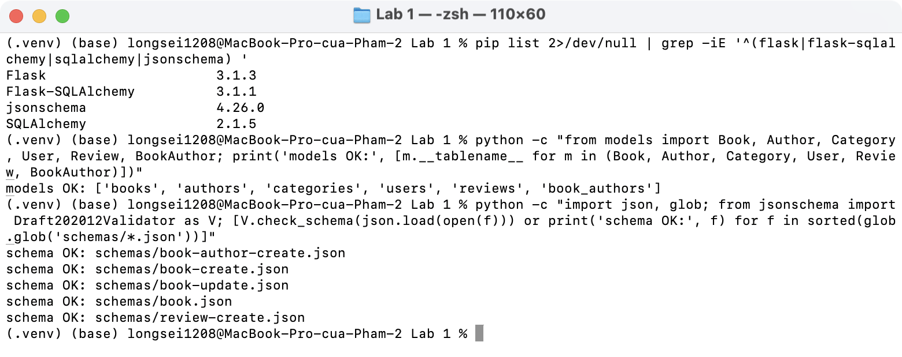

Server:

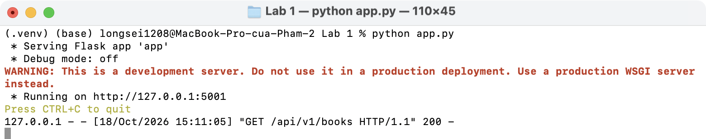

Representation của Book: ID có tiền tố, camelCase, `price` có currency, embed `category` + `authors` (kèm `role`), `createdAt` ISO 8601:

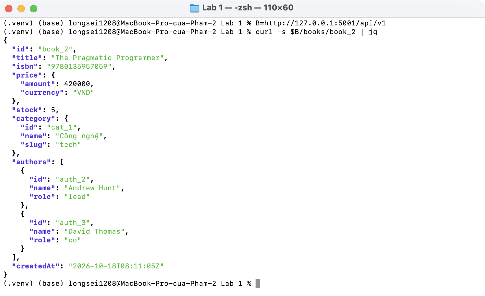

List + 404 (ID sai tiền tố cũng là 404):

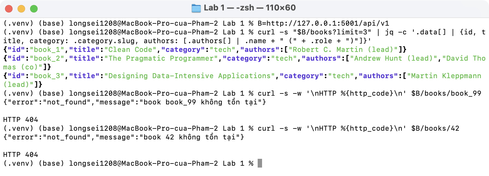

`POST /books`: 201 + `Location`; thiếu `title`, sai kiểu, gửi kèm `id` → 400 có `field`; category không tồn tại → 422; trùng isbn → 409:

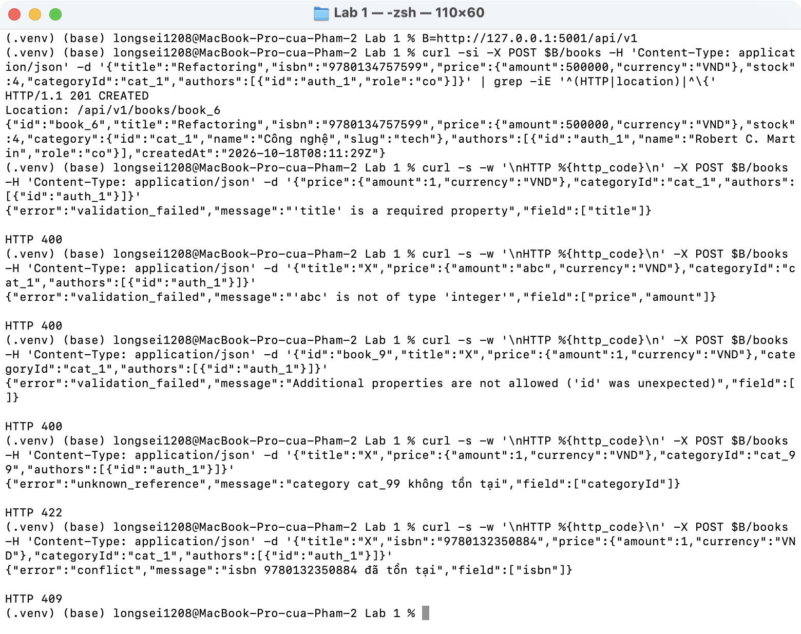

Review: nested `/books/{id}/reviews` và top-level `/reviews?user_id=`. User chỉ hiện `id` + `displayName`, không lộ email:

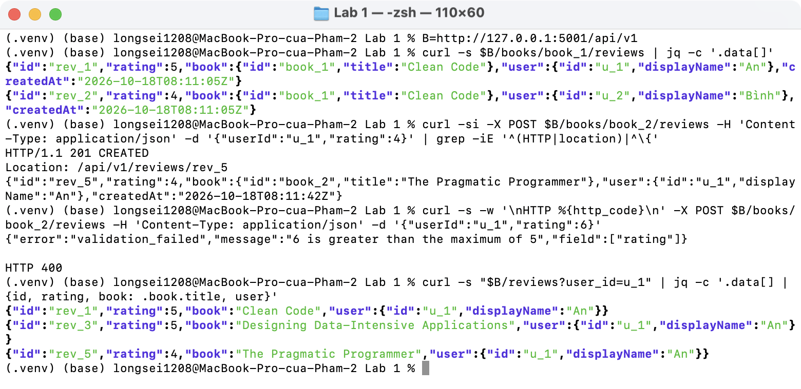

Junction Book–Author kèm `role`; thêm trùng cặp → 409; tác giả xem sách của mình:

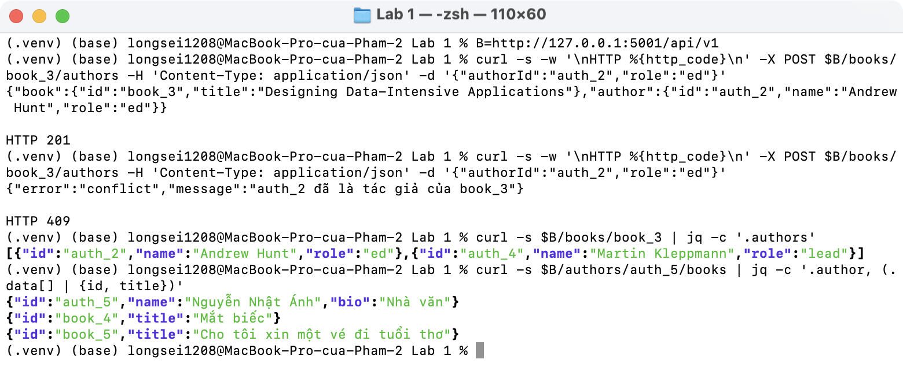

`PATCH` một phần, `PATCH {}` → 400, `DELETE` → 204 và review của sách bị xoá theo (`book_1` không còn trong `/reviews?user_id=u_1`), sai method → 405:

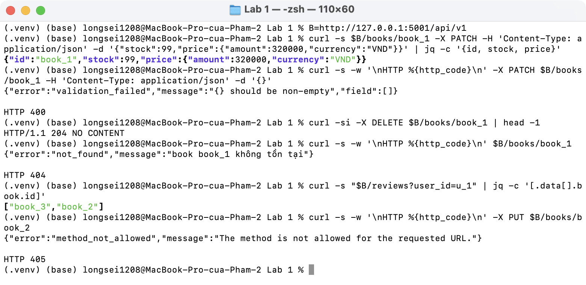

Log server:

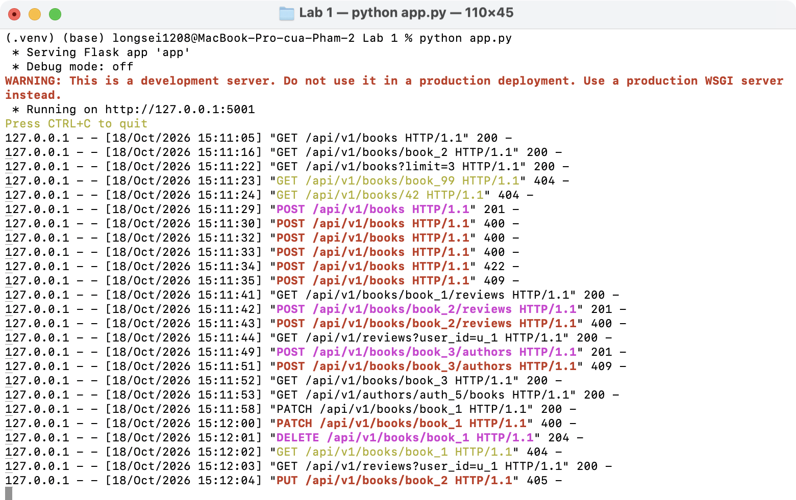

Tránh N+1: list 5 sách tốn 13 câu SQL nếu lazy loading, còn 4 câu (cố định) khi dùng `selectinload`:

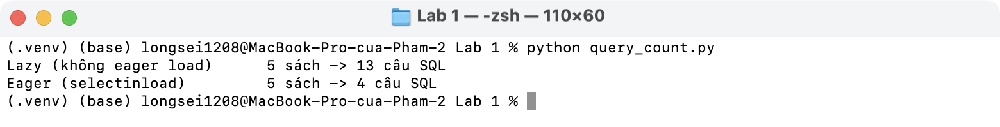
