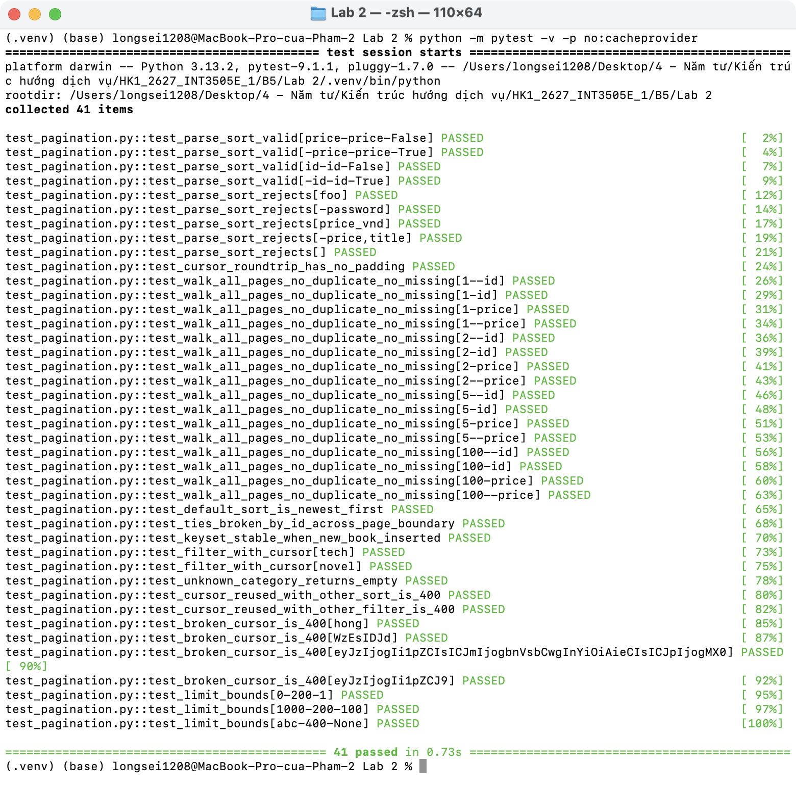
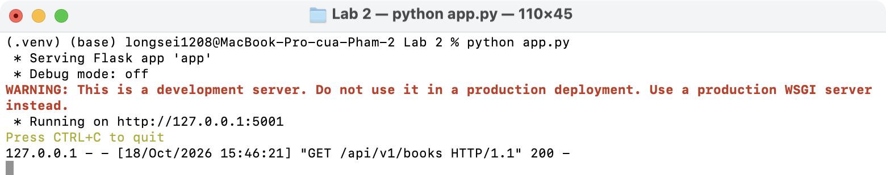
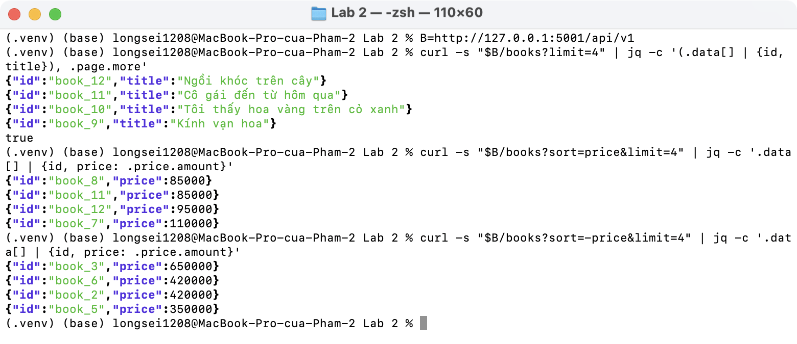
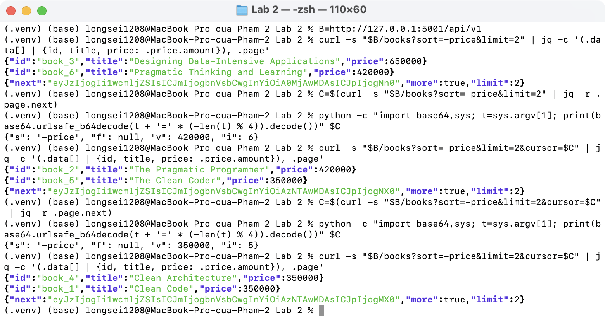
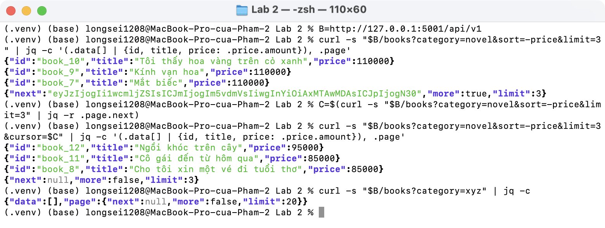
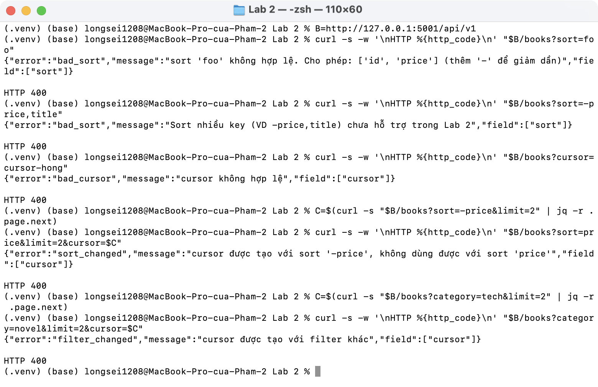
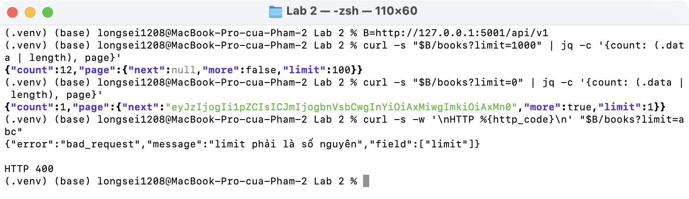
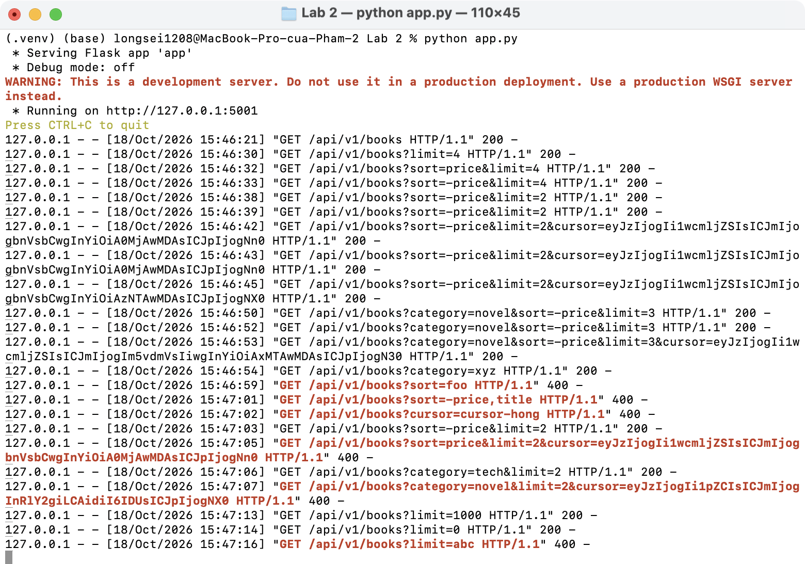

# Lab 2 · Sort, filter và cursor pagination cho Books

Tiếp nối [Lab 1](../Lab%201/README.md): giữ nguyên models, serializer, CRUD; chỉ thay `GET /api/v1/books` bằng bản có **sort (whitelist) + filter + cursor pagination**. Dữ liệu mẫu tăng lên 12 sách, có nhiều cuốn **trùng giá** (350000 ×3, 110000 ×3, 85000 ×2, 420000 ×2) để kiểm tra tie-break.

## Phần A · Thiết kế

### A1. Chọn chiến lược phân trang

| Tiêu chí (slide 22) | Bookstore cần gì | Chọn |
| ------------------- | ---------------- | ---- |
| Dữ liệu thay đổi (thêm sách mới) | Không được lặp / sót khi khách đang lướt | Cursor (offset bị lặp khi có sách mới chèn vào đầu) |
| Jump đến trang N | Trang danh sách sách dùng "Xem thêm", không cần "Trang 5/47" | Cursor (không cần jump) |
| Sort theo cột không duy nhất (price) | Nhiều sách trùng giá | **Composite cursor `(sort_value, id)`** |

### A2. Query parameters

| Param | Ví dụ | Quy tắc |
| ----- | ----- | ------- |
| `sort` | `price`, `-price`, `id`, `-id` | Whitelist `{"id": Book.id, "price": Book.price_vnd}`; `-` = giảm dần; mặc định `-id` (mới nhất); key khác hoặc nhiều key → 400 |
| `category` | `tech`, `novel` | Equality filter theo `slug` (quyết định top-level + filter ở Lab 1 A3); slug không tồn tại → `data: []` |
| `limit` | `20` | Mặc định 20, chặn trong khoảng 1–100; không phải số → 400 |
| `cursor` | `eyJzIjoi...` | Lấy từ `page.next` của trang trước |

Không đưa thẳng tên cột (`price_vnd`) ra API: client gửi `price`, server tra whitelist.

### A3. Cursor

Cursor là `base64url(JSON)` không padding, chứa:

```json
{"s": "-price", "f": null, "v": 420000, "i": 6}
```

| Field | Ý nghĩa | Vì sao cần |
| ----- | ------- | ---------- |
| `v`, `i` | Giá trị sort và `id` của phần tử cuối trang | Composite key: trang sau là `WHERE (price_vnd, id) < (420000, 6)` (giảm dần). Chỉ lưu `id` sẽ lặp/sót khi trùng giá |
| `s` | Sort lúc tạo cursor | Đổi sort mà dùng lại cursor → `400 sort_changed` |
| `f` | Filter `category` lúc tạo cursor | Đổi filter mà dùng lại cursor → `400 filter_changed` (production tip ⑤, slide 25) |

### A4. Response

```json
{"data": [...], "page": {"next": "eyJ...", "more": true, "limit": 2}}
```

Lấy `limit + 1` bản ghi: có bản ghi thứ `limit + 1` nghĩa là `more: true`, không cần `COUNT(*)`.

## Phần B · Code

3 helper trong [routes/pagination.py](routes/pagination.py), tách riêng để test đơn lẻ (slide 23):

| Helper | Việc |
| ------ | ---- |
| `parse_sort(raw)` | Tra whitelist, trả `SortSpec` với `order_by = [col, id]` cùng chiều |
| `apply_cursor(q, raw, spec, category)` | Decode cursor, kiểm tra `s`/`f`, thêm `WHERE tuple_(col, id) < / > tuple_(v, i)` |
| `build_response(rows, limit, spec, category)` | Cắt `limit`, sinh `page.next` từ phần tử cuối |

Route [routes/books.py](routes/books.py) `list_books` ghép 3 helper; vẫn dùng `selectinload` của Lab 1 để tránh N+1.

Khác với code mẫu trên slide: cursor hỏng (không phải base64/JSON, sai kiểu) trả `400 bad_cursor` thay vì lỗi 500; cursor ràng buộc cả filter.

## Kết quả chạy

```bash
source .venv/bin/activate
pip install -r requirements.txt
pytest -v
python app.py        # http://127.0.0.1:5001
```

41 test: `parse_sort`, đi hết các trang với 4 kiểu sort × 4 giá trị `limit` (không lặp, không sót, đúng thứ tự), trùng giá ở ranh giới trang, thêm sách mới giữa 2 lần gọi, filter + cursor, các lỗi 400:



Server:



Mặc định `-id` (mới nhất), `sort=price`, `sort=-price`:



Đi từng trang `sort=-price&limit=2`, giải mã cursor để thấy `(v, i)`. 3 cuốn giá 350000 (`book_5`, `book_4`, `book_1`) bị chia qua 2 trang nhưng không lặp, không sót, xếp theo `id` giảm dần:



Filter `category=novel` + cursor; slug không tồn tại trả danh sách rỗng:



Lỗi 400: sort ngoài whitelist, sort nhiều key, cursor hỏng, dùng lại cursor với sort khác / filter khác:



`limit` bị chặn trong 1–100; không phải số → 400:



Log server:


