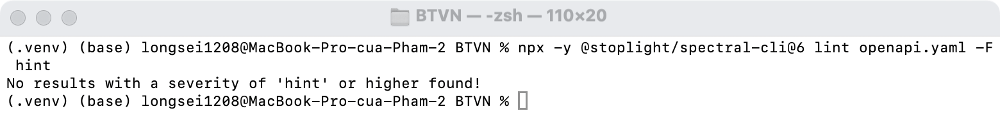
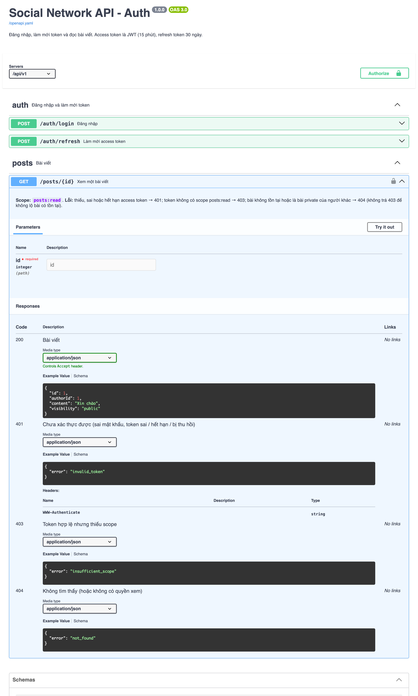
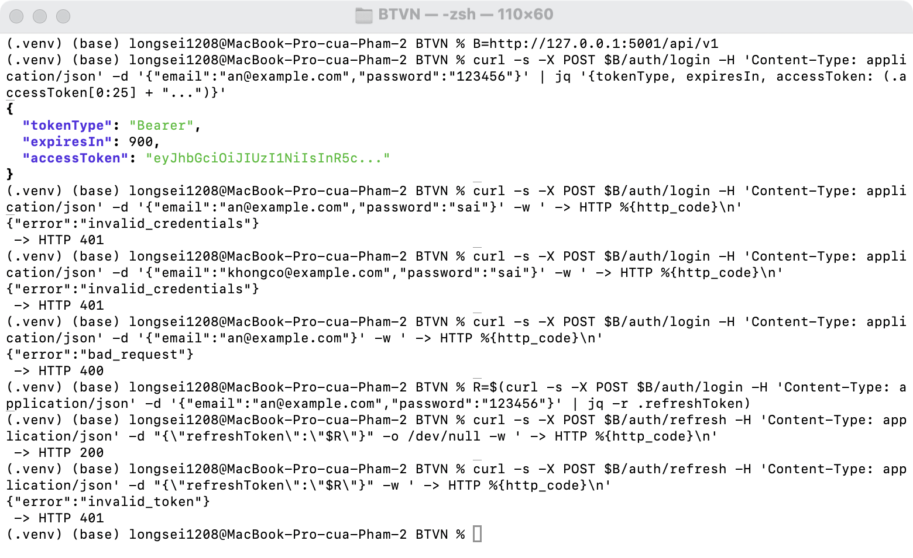
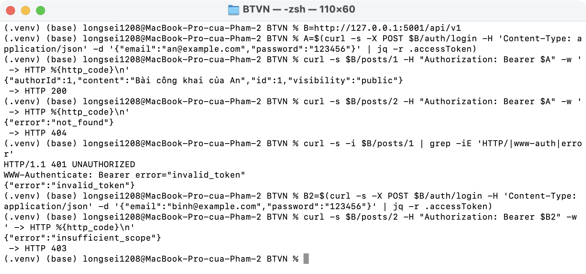
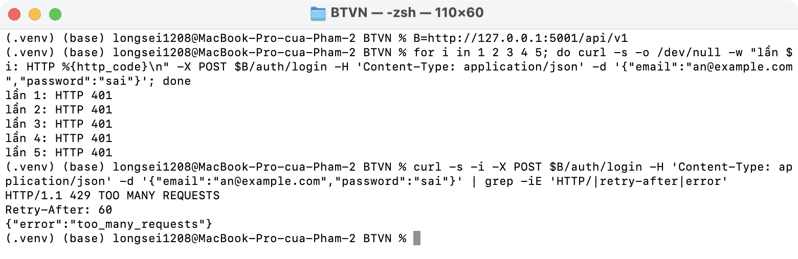
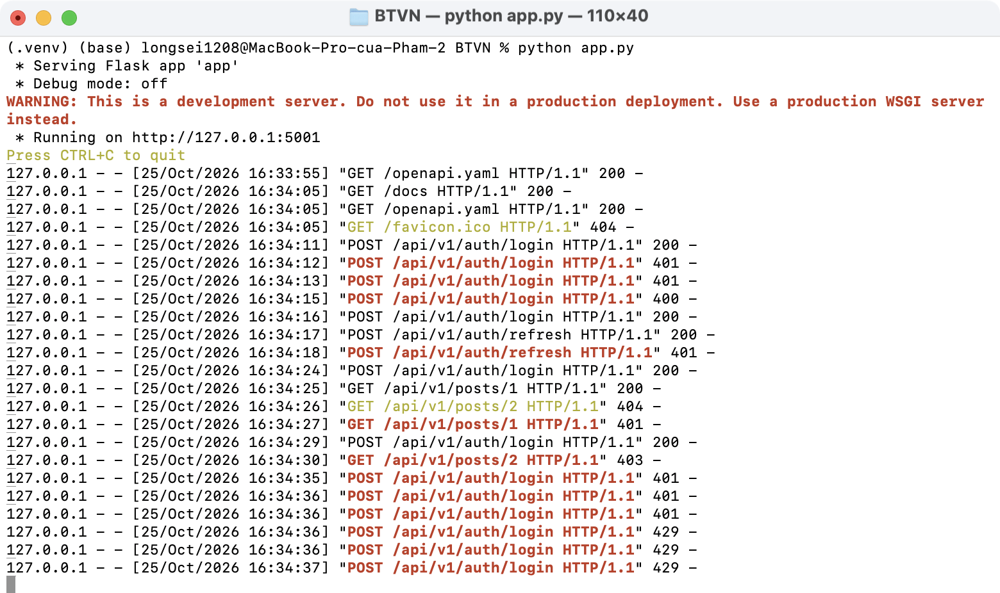

# BTVN Buổi 6 · Auth cho Social Network API

Đề: viết OpenAPI spec cho `POST /auth/login`, `POST /auth/refresh`, `GET /posts/{id}`; trả lời mỗi endpoint cần scope nào, lỗi nào có thể xảy ra, status code nào. Nộp kèm `SecurityAudit.md` liệt kê ≥ 5 điểm có thể lộ.

| File | Nội dung |
| ---- | -------- |
| [openapi.yaml](openapi.yaml) | Spec 3 endpoint (OpenAPI 3.0.3) |
| [SecurityAudit.md](SecurityAudit.md) | 6 điểm có thể lộ |
| [app.py](app.py) | Flask + Flask-JWT-Extended chạy theo spec, Swagger UI tại `/docs` |

## Trả lời đề

| Endpoint | Scope | Lỗi có thể xảy ra | Status |
| -------- | ----- | ----------------- | ------ |
| `POST /auth/login` | Không (public) | Body sai; sai email/mật khẩu (cùng một thông báo); sai quá 5 lần/phút | 200, 400, 401, 429 |
| `POST /auth/refresh` | Không, xác thực bằng refresh token | Thiếu token; token sai, hết hạn hoặc đã dùng (mỗi refresh token chỉ dùng 1 lần) | 200, 400, 401 |
| `GET /posts/{id}` | `posts:read` | Thiếu/sai/hết hạn access token; thiếu scope; bài không tồn tại hoặc bài private của người khác | 200, 401, 403, 404 |

## Chạy

```bash
python3 -m venv .venv && source .venv/bin/activate
pip install -r requirements.txt
python app.py        # http://127.0.0.1:5001/docs
```

Tài khoản mẫu: `an@example.com` / `123456` (có scope `posts:read`), `binh@example.com` / `123456` (không có scope).

## Minh chứng

Spec không có lỗi (Spectral):



Swagger UI tại `/docs`:



Login (sai email hay sai mật khẩu đều cùng `401`) và refresh (dùng lại token cũ → `401`):



`GET /posts/{id}`: bài public → 200; bài private của người khác → 404; không token → 401 + `WWW-Authenticate`; thiếu scope → 403:



Sai mật khẩu quá 5 lần → 429 + `Retry-After`:



Log server:


