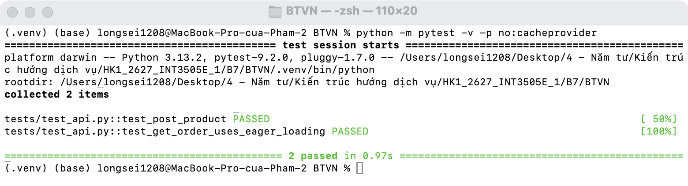
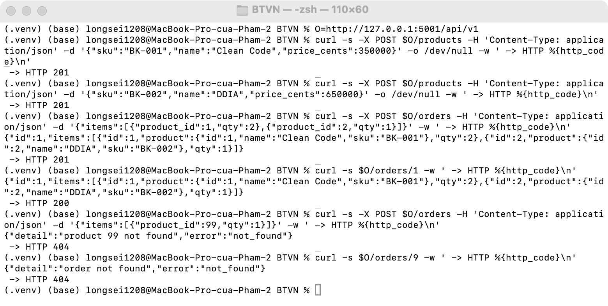
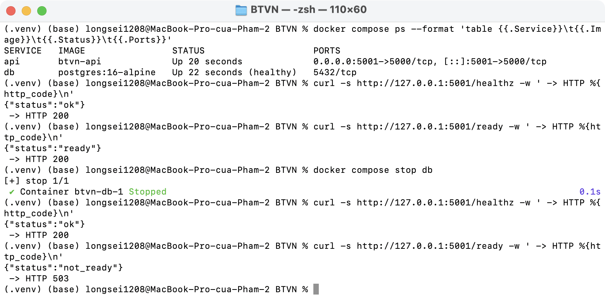
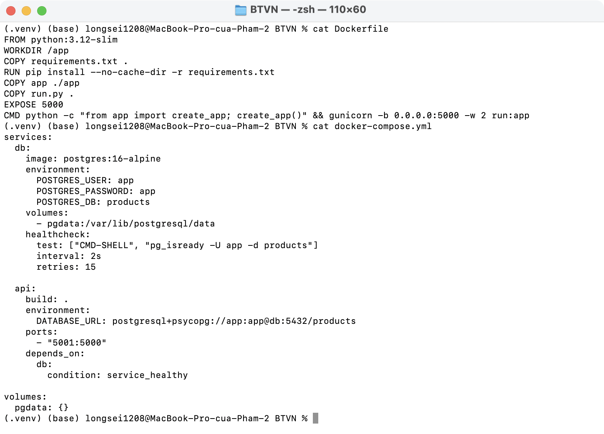
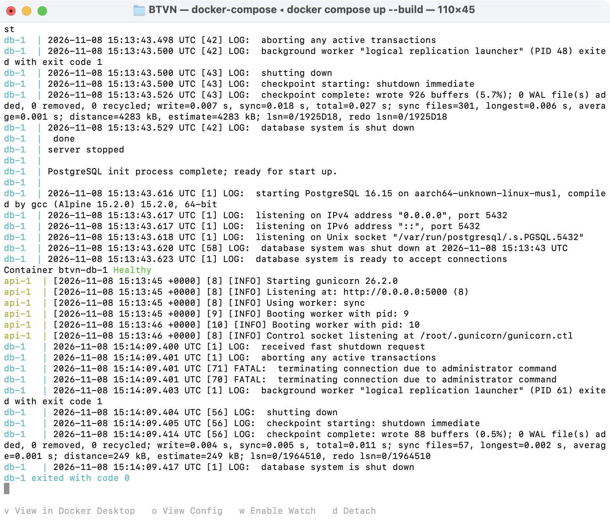

# BTVN Buổi 7

1. Lab 1: `app/api/products.py`
2. OrderItem, `/api/v1/orders`: `app/api/orders.py`
3. Docker: `Dockerfile`, `docker-compose.yml`
4. `/healthz`, `/ready`: `app/api/health.py`
5. pytest: `tests/test_api.py`

```bash
docker compose up --build
pytest -v
```










