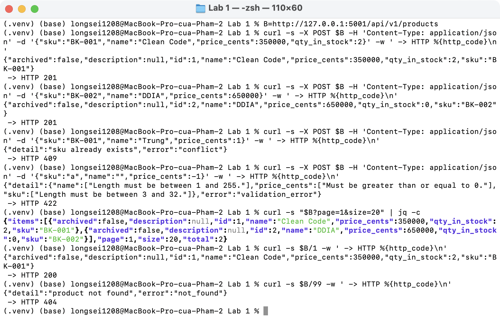
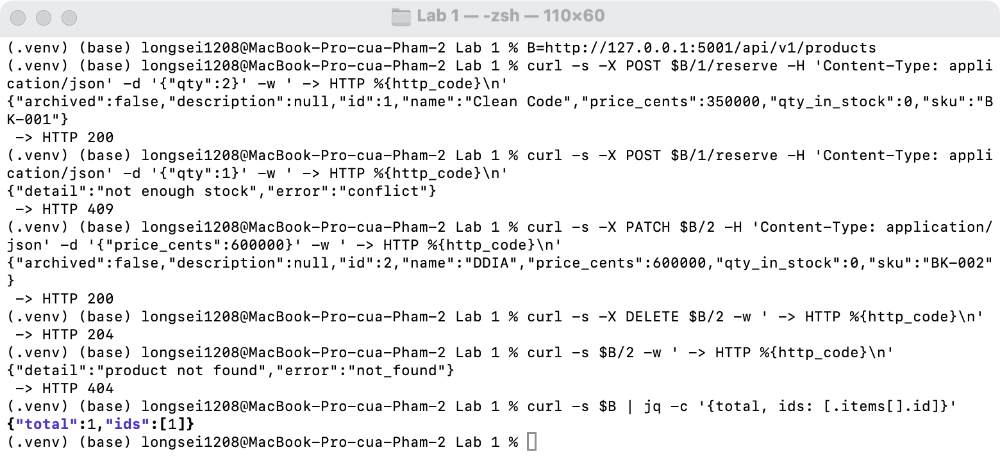
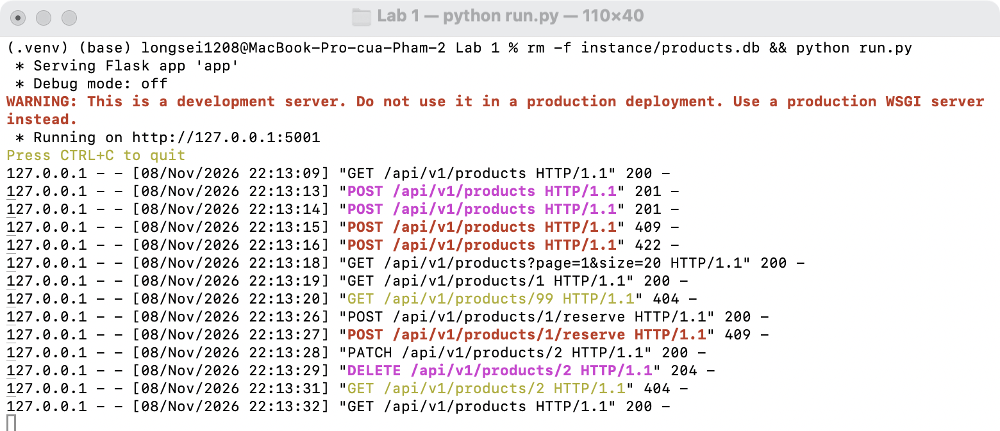

# Lab 1 · Product API

| Method | Endpoint |
| ------ | -------- |
| GET | `/api/v1/products?page=1&size=20` |
| GET | `/api/v1/products/<id>` |
| POST | `/api/v1/products` |
| POST | `/api/v1/products/<id>/reserve` |
| PATCH | `/api/v1/products/<id>` |
| DELETE | `/api/v1/products/<id>` |

```bash
pip install -r requirements.txt
python run.py
```






